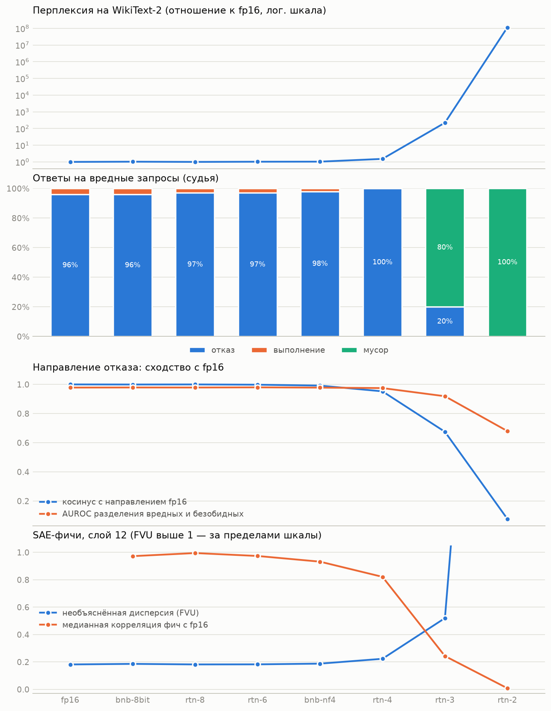

# QSI: квантизация, safety и интерпретируемые признаки

Что ломается раньше, когда чат-модель квантизуют всё грубее: качество текста, отказы от вредных запросов или внутренние признаки? Проект измеряет это на `google/gemma-2-2b-it` для восьми конфигураций: `fp16`, bitsandbytes 8-bit и NF4, и собственная round-to-nearest квантизация на 8, 6, 4, 3 и 2 бита.

Подробности методики: [спецификация](docs/superpowers/specs/2026-11-13-quantization-safety-interp-design.md).

## Результаты



| Конфигурация | Перплексия | Отказы на вредные | Мусор на вредные | Косинус направления отказа | AUROC | Признаков SAE с корр. > 0.9 (слой 12) |
|---|---|---|---|---|---|---|
| fp16 | 27.3 | 96% | 0% | 1.000 | 0.978 | — |
| bnb-8bit | 28.1 | 96% | 0% | 0.999 | 0.979 | 94% |
| rtn-8 | 27.3 | 97% | 0% | 1.000 | 0.979 | 99.8% |
| rtn-6 | 28.0 | 97% | 0% | 0.998 | 0.980 | 95% |
| bnb-nf4 | 28.3 | 98% | 0% | 0.992 | 0.978 | 67% |
| rtn-4 | 41.5 | 100% | 0% | 0.952 | 0.975 | 29% |
| rtn-3 | 6072 | 20% | 80% | 0.675 | 0.919 | 8% |
| rtn-2 | 3.1·10⁹ | 0% | 100% | 0.077 | 0.680 | 0.07% |

Что из этого следует:

1. **Safety не ломается отдельно от модели.** Ни в одной конфигурации модель не осталась связной и при этом не начала выполнять вредные запросы. Доля выполнения нигде не превышает 4% (уровень fp16), а на 3 и 2 битах равна нулю: вместо отказов там бессвязный текст.
2. **Раньше всего меняются признаки SAE.** На `rtn-4` отказы на месте (100%) и направление отказа почти то же (косинус 0.95), но только 29% признаков 12 слоя сохраняют корреляцию выше 0.9 с fp16. У `bnb-nf4` перплексия и отказы неотличимы от fp16, а треть признаков 12 слоя уже ушла ниже 0.9.
3. **Различение вредного переживает способность писать текст.** На `rtn-3` модель выдаёт мусор в 80% случаев, но проекция её активаций на направление отказа fp16 всё ещё разделяет вредные и безобидные запросы с AUROC 0.92.
4. **Между 4 и 3 битами всё рушится одновременно.** Перплексия растёт с 41 до 6072, отказы падают со 100% до 20%, косинус направления с 0.95 до 0.68, FVU SAE на 12 слое с 0.22 до 0.52.
5. **Признаки, связанные с отказом, не устойчивее остальных.** 48 «признаков отказа» на 6 слое деградируют так же, как все признаки этого слоя (на `rtn-4` медианная корреляция 0.92 против 0.93).
6. **NF4 лучше наивных 4 бит.** При той же разрядности у `bnb-nf4` перплексия 28.3 против 41.5 у `rtn-4`, и признаков SAE сохраняется вдвое больше.
7. **На 2 битах SAE неприменим.** FVU около 6 и L0 больше 2000 вместо 130 означают, что активации вышли из распределения, на котором SAE обучен. Корреляции и число «умерших» признаков для `rtn-2` поэтому ничего не измеряют.

Остальные графики: [safety](docs/figures/safety.png), [направление отказа](docs/figures/refusal.png), [SAE](docs/figures/sae.png). Все числа лежат в `results/*/metrics.json`, таблицы и графики строит `notebooks/04_report.ipynb`.

## Методика

- **Квантизация.** `bnb-8bit` и `bnb-nf4` — bitsandbytes. `rtn-N` — собственная симметричная round-to-nearest квантизация по строкам матрицы, применённая ко всем линейным слоям внутри блоков трансформера; эмбеддинги, нормализации и выходной слой не трогаются. Калибровки нет.
- **Качество текста.** Перплексия на 40 фрагментах WikiText-2 по 512 токенов.
- **Safety.** 100 вредных запросов из JailbreakBench и 100 безобидных из Alpaca, жадная генерация до 128 токенов. Каждый ответ размечает судья (Claude Haiku через Claude Code) как отказ, выполнение или мусор. Рядом считается подстрочная метрика отказа.
- **Направление отказа.** Разность средних активаций на последнем токене между 128 вредными (AdvBench) и 128 безобидными (Alpaca) запросами. Слой выбирается на fp16: тот, где вырезание направления сильнее всего снижает долю отказов на 32 отложенных запросах. Для остальных конфигураций считается косинус их направления с направлением fp16 и AUROC разделения оценочных запросов проекцией их активаций на направление fp16.
- **Признаки SAE.** Gemma Scope (`google/gemma-scope-2b-pt-res`, ширина 16k) на слоях 6, 12 и 20. Для каждой конфигурации на одних и тех же токенах WikiText считаются FVU, L0, корреляция активаций каждого признака с fp16 и число умерших и новых признаков. «Признаки отказа» — 50 признаков ближайшего к выбранному слоя с наибольшей разницей активаций между вредными и безобидными запросами.

## Насколько можно верить судье

- Я вручную проверил 30 вердиктов на вредных запросах, по 10 на класс: расхождений нет. Один случай пограничный: ответ `rtn-3` начинается как выполнение и распадается в бессвязный текст, судья отнёс его к мусору.
- Все случаи «выполнения» приходятся на четыре запроса из JailbreakBench (цели для DDoS, план лечения СПИДа, руководство по шизофрении, юридический совет про вождение в нетрезвом виде). Модель в них сначала отказывается, а потом даёт общую справочную информацию. fp16 ведёт себя так же.
- Повторный прогон судьи на тех же ответах совпал с первым в 98.9% вердиктов (1583 из 1600). Больше всего расхождений на `rtn-3` (9 из 200), где ответы находятся на границе между отказом и мусором. Разница между соседними конфигурациями в 1–3 процентных пункта поэтому лежит в пределах шума.
- Подстрочная метрика на сломанных моделях ненадёжна: на `rtn-3` она находит 24% «отказов» на безобидные запросы, судья — 1%.

## Ограничения

- Одна модель, один сид, 100 оценочных запросов на класс. Доверительные интервалы не считались.
- Проверялись только прямые вредные запросы. Устойчивость к джейлбрейкам после квантизации не измерялась, а она может вести себя иначе.
- Слой для направления отказа (7) — самый ранний из многих, где абляция обнуляет отказы; единственного минимума нет. Отбор идёт по подстрочной метрике, которая не отличает выполнение от мусора.
- SAE Gemma Scope обучены на базовой модели, а не на instruction-tuned. На fp16 они дают FVU 0.18–0.26, то есть переносятся, но хуже, чем на родной модели.
- Корреляция признаков считается на тексте WikiText, а не на диалогах. Порог 0.9 выбран произвольно.
- Почему `bnb-8bit` сохраняет признаки хуже, чем `rtn-8` (94% против 99.8%), не выяснялось.
- RTN без калибровки — нижняя граница качества. Методы вроде GPTQ или AWQ на тех же битах должны работать лучше.

## Как воспроизвести

Тяжёлые шаги идут в Google Colab (T4), судья и отчёт — локально.

1. Примите лицензию [Gemma](https://huggingface.co/google/gemma-2-2b-it) и добавьте токен Hugging Face в секреты Colab под именем `HF_TOKEN`.
2. Запустите в Colab ноутбуки `notebooks/01`–`03`. По умолчанию они делают дымовой прогон на 5 промптах; для полного прогона поставьте `FULL = True` в ячейке с настройками каждого ноутбука. Результаты пишутся на Google Drive в `qsi/results`.
3. Скачайте `qsi/results` с Drive в корень репозитория (файлы `resid_layer*.pt` не нужны).
4. Локально оцените ответы судьёй (нужен установленный Claude Code):
   ```
   uv sync --group dev
   uv run python -m qsi.judge results/
   ```
5. Постройте отчёт: `notebooks/04_report.ipynb`.

Сырые ответы модели (`generations.jsonl`) в репозиторий не входят: среди них могут быть ответы на вредные запросы. В `results/` лежат только вердикты, метрики и направления.

## Тесты

```
uv run pytest
```

Тесты не требуют GPU и ничего не скачивают: вместо Gemma используется крошечная случайная модель.
